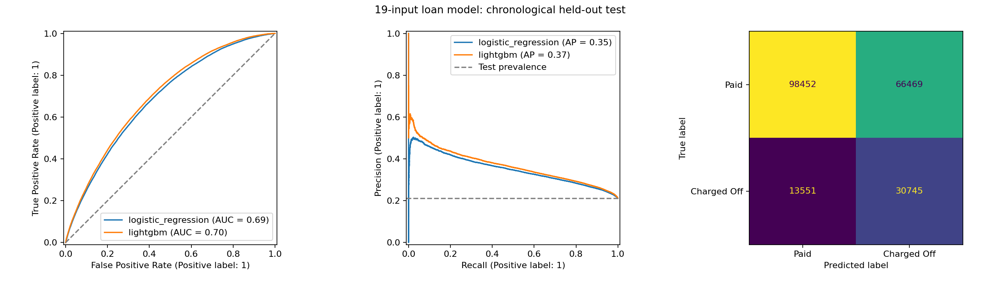

# Loan Default Risk: evaluated model and prediction API

A Python portfolio project that trains a LightGBM model on LendingClub loans
and serves the evaluated model through FastAPI. The saved pipeline includes
training-only missing-value imputation and accepts the 19 fields documented at
`/docs`. The API uses the validation-selected classification threshold from the
same evaluation run, rather than a hardcoded 0.5.

## Measured results

The model was evaluated on **209,217 later-issued loans**, after training and
validation on earlier issuance periods. These are results for the pipeline
included in `artifacts_19/`, not the older model previously in this repository.

| Model | Test ROC-AUC | Test average precision |
|---|---:|---:|
| Constant-prior baseline | 0.5000 | 0.2117 |
| Logistic regression | 0.6878 | 0.3507 |
| LightGBM | **0.7012** | **0.3670** |

At threshold **0.1678487251788922**, selected by validation F1, LightGBM has
charge-off precision **31.63%**, recall **69.41%**, and F1 **0.4345**.
False positives remain substantial. See [the results summary](Results_Loan_19.md),
[full metrics](artifacts_19/metrics_19.json), and the executed notebook.



## Install and start the API

Use **Python 3.12**. From the repository root, create and activate an environment:

```powershell
py -3.12 -m venv .venv
.\.venv\Scripts\Activate.ps1
python -m pip install -r requirements.txt
python -m uvicorn app.main:app --reload
```

If `py` is unavailable, use the path to your Python 3.12 executable in the first
command. On macOS/Linux use `python3.12 -m venv .venv` and
`source .venv/bin/activate`; the pip and uvicorn commands are the same.

Open [interactive API documentation](http://127.0.0.1:8000/docs).
The API can run using the included model artifacts; it does not need the raw
dataset and does not retrain on startup.

| Endpoint | Purpose |
|---|---|
| `GET /` | Basic API information |
| `GET /health` | Model status, 19-field input count, and loaded threshold |
| `POST /predict` | Model score, predicted class, risk label, and threshold |

## Example request

In another PowerShell terminal, from the repository root:

```powershell
$requestBody = Get-Content -Raw .\artifacts_19\example_request.json
Invoke-RestMethod -Uri http://127.0.0.1:8000/predict -Method Post -ContentType 'application/json' -Body $requestBody
```

The included example is constructed from training-set medians, not a real
borrower's record. Its expected response is:

```json
{
  "prediction": "Fully Paid",
  "default_probability": 0.16185353724903404,
  "risk_level": "Low",
  "threshold": 0.1678487251788922
}
```

`Default` and `High` mean the score is **greater than or equal to** the saved
threshold. `Fully Paid` and `Low` mean it is below the threshold. The name
`default_probability` is retained from the earlier API, but calibration as a
real-world probability has not been established. Do not interpret the risk label
as an independently validated policy.

### Input units and validation

See `artifacts_19/example_request.json` for all 19 fields and
`artifacts_19/feature_columns_19.json` for their order.

- `term`: 36 or 60 months.
- `grade`: A=0 through G=6.
- `emp_length`: whole years; less than one year=0, ten or more years=10.
- `int_rate`, `dti`, `revol_util`: percentage points; 13.99 means 13.99%, not 0.1399.
- `loan_amnt`, `installment`, `annual_inc`, `revol_bal`: US dollars.
- `credit_history_years`: issue calendar year minus earliest-credit-line calendar year.
- FICO bounds: 300-850, with the low bound no greater than the high bound.
- Credit-account and event counts: nonnegative whole numbers.
- `pymnt_plan`: always 0. This compatibility field is inactive to avoid using
  possible post-origination information. There are at most 18 informative predictors.
- Fields documented as nullable at `/docs` accept explicit `null`; the fitted
  training medians fill these values. Fields must still be provided unless a
  default is documented. Unknown keys and invalid values return HTTP 422.

## Run integration tests

```powershell
python -m pip install -r requirements-dev.txt
python -m pytest -q
```

Tests check the recorded example against the API, successful model startup,
documentation, the evaluated threshold, missing-value handling, and invalid
inputs. A score between the evaluated threshold and 0.5 is explicitly checked
to catch accidental use of the old decision rule.

## Reproduce training

1. Obtain the accepted-loans CSV from the
   [All Lending Club loan data dataset](https://www.kaggle.com/datasets/wordsforthewise/lending-club).
   Sign in if required, download the accepted-loans archive, and extract
   `accepted_2007_to_2018Q4.csv`.
2. Place it at `data/raw/accepted_2007_to_2018Q4.csv`. The dataset is deliberately
   excluded from Git. The version used has **2,260,701 rows** and a file size of
   **1,675,133,810 bytes**; another export may produce different results.
3. Open `Loan_Default_19_Training_Evaluation.ipynb` in VS Code or Jupyter with
   the Python environment above. Your editor may ask you to install `ipykernel`.
4. Run all cells from the repository root. This recreates `artifacts_19/`,
   including the model, preprocessing, metrics, and example. Rerunning replaces
   the new artifacts; save a version before experimenting.

Training uses only accepted loans labeled `Fully Paid` (0) or `Charged Off` (1).
Other statuses are excluded. Entire issue months stay within one split:

| Split | Issuance period | Loans |
|---|---|---:|
| Training | June 2007-March 2016 | 938,537 |
| Validation | April 2016-January 2017 | 197,556 |
| Test | February 2017-December 2018 | 209,217 |

Only training data fits imputation and model parameters. Validation data selects
boosting iterations and the classification threshold; final scores use the test
set. Training code is in the notebook, serving code in `app/main.py`.

## Project files

```text
app/main.py                              FastAPI application
tests/test_api.py                        API integration tests
Loan_Default_19_Training_Evaluation.ipynb Executed training and evaluation
requirements.txt                         API + model dependencies
requirements-dev.txt                     Test dependencies
requirements_loan19.txt                  Training dependencies
Results_Loan_19.md                        Human-readable model results
artifacts_19/                            Pipeline, metrics, plot, examples
data/raw/                               Local-only dataset; excluded from Git
```

## Limitations and project history

This is an educational model of **charge-off versus full repayment among resolved,
accepted loans**, using information available around issuance. Interest rate and
grade are already assigned; this is not a pre-underwriting loan approval model.

Unresolved loans are excluded, newer cohorts have less follow-up, and final
outcomes are taken from the historical snapshot. Chronological separation does
not remove maturity/selection bias or reconstruct label availability at each
historical cutoff. Calibration and subgroup fairness have not been established.
Input features match the existing app schema; they have not been proven optimal.

The earlier notebook's 0.7387 ROC-AUC described a different, larger model and
random split. It should not be attributed to this pipeline or directly compared
as if the experiments were identical. Older local files are preserved separately;
they are not needed to run this repository.
